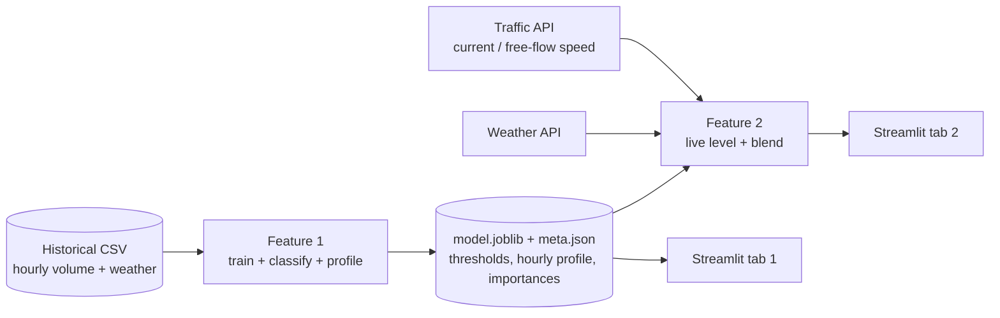

# ARCHITECTURE: Traffic Congestion Forecasting (5–120 min)

Feature names match PRD.md: **Feature 1: Pattern Learning & Congestion Classifier**, **Feature 2: Live Integration & 5–120 min Forecasting**.

## 1. Overview



Data flow: history → model and profile (saved once) → live fetch → blend → chart.

## 2. Tech stack

| Tool | Why |
|---|---|
| Python 3 | Fastest option for ML plus a UI |
| pandas, numpy | Data cleaning and features |
| scikit-learn (HistGradientBoostingClassifier or RandomForestClassifier) | Well known, nothing extra to install. Use `permutation_importance` or `feature_importances_` for the factors |
| joblib | Save and load the model |
| requests | Call the two HTTP APIs |
| Streamlit | A UI in about 50 lines, with a slider and tabs |
| Plotly | Interactive charts that work inside Streamlit |
| python-dotenv | Keep the API key out of the code |
| TomTom Traffic Flow API (Flow Segment Data) | I believe it returns current speed and free-flow speed for a point and needs a free key. **Not verified:** check the docs, the free-tier limits and Indian coverage |
| Open-Meteo | I believe it is free, needs no key, and gives current temperature, precipitation and cloud cover. **Not verified:** check variable names |

## 3. Components

### Feature 1: Pattern Learning & Congestion Classifier
- **Inputs:** historical CSV (datetime, traffic volume, weather columns, holiday column).
- **Processing:**
  1. Clean the data and set the datetime index. Drop duplicate timestamps.
  2. Build features: hour, day-of-week, month, is_weekend, holiday flag, temp_c, rain_mm, clouds_pct, lag_24h, lag_168h.
  3. Define levels from volume percentiles. Default cut points: Low < P40, Moderate P40–P70, High P70–P90, Severe > P90. This is our choice, and the values are saved in `meta.json`.
  4. Split by time (last 20% as test). Train. Print macro-F1 and the hour-of-week baseline score.
  5. Compute the hourly profile (mean predicted volume by hour-of-week, plus the weekday vs weekend curves) and the feature importances.
- **Outputs:** `models/model.joblib`, `models/meta.json`, and the UI tab (level, factors chart, weekday-vs-weekend chart).
- **Files:** `src/features.py`, `src/train.py`, `src/profile.py`, `src/ui_f1.py`.
- **Dependencies:** none. Everything else depends on it.
- **Assumption:** for a future time with no real history, lag_24h and lag_168h use the hour-of-week average volume. This is a proxy, and it is stated in the UI.

### Feature 2: Live Integration & 5–120 min Forecasting
- **Inputs:** lat/lon from a hardcoded location list, an optional holiday checkbox, the API key, and `meta.json` plus the model from Feature 1.
- **Processing:**
  1. Call the traffic API and compute `ratio = currentSpeed / freeFlowSpeed`.
  2. Map the ratio to a live level. Thresholds are our assumption, not from the API: >0.8 Low, 0.6–0.8 Moderate, 0.4–0.6 High, <0.4 Severe.
  3. Convert levels to a common index in [0, 1] using the midpoints of the percentile bands: Low 0.20, Moderate 0.55, High 0.80, Severe 0.95.
  4. Fetch weather and build the model features for now and for each horizon.
  5. Get `profile_index(t)` = percentile rank of the model's predicted volume. For sub-hour horizons, interpolate linearly between the hourly points. State this in the UI.
  6. Blend: `index(h) = profile(now + h) + (live_index − profile(now)) × w(h)`, with `w(h) = exp(−h / τ)`. Use τ = 60 min as an assumed default. If you log enough live data, fit τ and say so.
  7. Clip to [0, 1] and map back to levels using the percentile thresholds.
- **Weights with τ = 60:** 5 min 0.92, 10 min 0.85, 15 min 0.78, 30 min 0.61, 60 min 0.37, 90 min 0.22, 120 min 0.14.
- **Outputs:** the current live level, the 7 forecast levels and indices, a weight table (live vs history), a forecast chart, and a "Simulate live speed ratio" slider that overrides the live value (labelled as a simulation).
- **Files:** `src/config.py` (locations, thresholds, τ), `src/live.py` (APIs), `src/blend.py` (blend and mapping), `src/ui_f2.py`, optional `scripts/log_live.py`.
- **Dependencies:** Feature 1's model, `meta.json` and profile.
- **Location list (approximate city-centre coordinates, replace with exact road points):** Mumbai 19.0760, 72.8777; Pune 18.5204, 73.8567; Ratnagiri (Konkan) 16.9902, 73.3120.

## 4. Data

| Data | Source | Storage |
|---|---|---|
| Historical traffic | Organizer-provided dataset. Fallback: UCI "Metro Interstate Traffic Volume" (columns I recall: holiday, temp in Kelvin, rain_1h, snow_1h, clouds_all, weather_main, date_time, traffic_volume. **Not verified**, check before use) | `data/raw/traffic.csv` |
| Processed features | Generated by `train.py` | `data/processed/features.parquet` or CSV |
| Model, thresholds, profile | Generated by `train.py` | `models/` |
| Live speed | Traffic API | Not stored. Optional log in `data/live_log.csv` |
| Live weather | Weather API | Not stored |
| Sample live response | One saved real response, used as the fallback | `data/sample_live.json` |

Note: the profile comes from the historical dataset's city. Applying it to Mumbai, Pune or Konkan is an assumption and is not validated.

## 5. Folder structure

```
traffic-forecast/
├── app.py                 # Streamlit entry, two tabs
├── requirements.txt
├── .env.example           # TRAFFIC_API_KEY=
├── data/
│   ├── raw/traffic.csv
│   ├── processed/
│   ├── sample_live.json
│   └── live_log.csv       # optional
├── models/
│   ├── model.joblib
│   └── meta.json
├── src/
│   ├── config.py
│   ├── features.py        # F1
│   ├── train.py           # F1
│   ├── profile.py         # F1
│   ├── live.py            # F2
│   ├── blend.py           # F2
│   ├── ui_f1.py
│   └── ui_f2.py
├── scripts/log_live.py    # optional
└── tests/test_blend.py    # 2–3 checks on the blend
```

## 6. Build order (6 hours)

| Time | Step | Min |
|---|---|---|
| 0:00–0:30 | Setup: check dataset columns, get the traffic API key and test one call, test the weather call, create the repo and `requirements.txt`, start `log_live.py` if it is written | 30 |
| 0:30–1:30 | Feature 1: features, levels, train, evaluate, profile, importances, tab 1 | 60 |
| 1:30–2:50 | Feature 2: live fetch, ratio to level, weather, blend, weight table, forecast chart, slider, tab 2 | 80 |
| 2:50–3:30 | Integrate in `app.py`, run end to end, `test_blend.py` | 40 |
| 3:30–4:00 | Buffer and bug fixes. **Feature freeze at 4:00** | 30 |
| 4:00–4:45 | Test 3 locations and 3 times, record a backup demo video | 45 |
| 4:45–5:30 | Pitch slides and demo script | 45 |
| 5:30–6:00 | Rehearse twice and submit | 30 |

With 3 people, Feature 1 and Feature 2 can run in parallel after setup. Agree the interface first: Feature 1 exposes `predict_profile(datetime) -> index`, and Feature 2 exposes `forecast(location, now) -> 7 levels + weights`.

## 7. Risks and backups

| Feature | What could break | Simpler fallback |
|---|---|---|
| Feature 1 | Dataset columns differ from what is assumed. Model is no better than baseline. | Adapt features to the real columns. If the model does not beat the baseline, use the hour-of-week average level as the profile and report that honestly. |
| Feature 1 | Indian-city mismatch with the historical city | Say it in the pitch. The profile is a reference pattern and has not been validated on Indian roads. |
| Feature 2 | Traffic API gives no data for a rural point (likely for Konkan) | Use highway or city points only, or load `data/sample_live.json` and say so. |
| Feature 2 | API key, rate limit or wifi failure during the demo | Use the saved sample response, the slider, and the backup video. |
| Feature 2 | Weather variable names differ from what is assumed | Hardcode the weather inputs in a dropdown (Clear / Rain) for the demo. |
| Feature 2 | The blend cannot be validated, because only a short live log exists | Present as a proof of concept, show τ as an assumption, and avoid accuracy claims for 5/10/15 min. |
