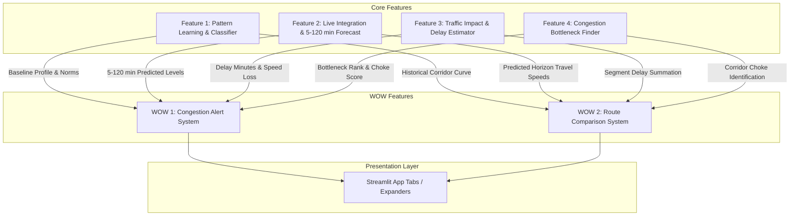

# ARCHITECTURE_WOW: Congestion Alert System & Route Comparison System

Assumption: Built on the existing Python + Streamlit codebase using the 31 corridor segments in `data/mumbai_thane_traffic_historical.csv`.

## 1. Overview

---

## 2. Tech Stack

| Tool | Why |
|---|---|
| Python 3 (built-in standard library) | Aggregation rules, alert threshold checks, and route summation without extra overhead. |
| pandas | Multi-segment route grouping and comparative metric tables. Already in core stack. |
| Streamlit (`st.error`, `st.warning`, `st.columns`, `st.metric`) | Renders instant alert banners and side-by-side comparison cards. Already in core stack. |
| Plotly (`go.Bar` / grouped comparison chart) | Side-by-side travel time comparison bar chart across horizons. Already in core stack. |
| *No new external libraries or paid APIs required.* | Kept strictly within zero-install footprint to eliminate 6-hour hackathon installation risk. |

---

## 3. Components

### WOW Feature 1: Congestion Alert System
- **HOW it is built:**
  - **Inputs:** Current and 7-horizon forecast results from Feature 2 (`blended_index`, `predicted_level`), estimated delay minutes from Feature 3 (`delay_minutes`), bottleneck severity from Feature 4 (`bottleneck_rank`), and user threshold settings (default: Level $\ge$ High, Delay $\ge$ 15 min).
  - **Processing steps:**
    1. Scan forecast horizons `h in [5, 10, 15, 30, 60, 90, 120]`.
    2. Check alert condition: `predicted_level in ["High", "Severe"]` OR `delay_minutes > threshold`.
    3. Determine earliest trigger horizon ($h_{\text{trigger}}$) and peak severity horizon ($h_{\text{peak}}$).
    4. Construct severity level: `INFO` (Moderate delay), `WARNING` (High congestion in $\le 30$ min), `CRITICAL` (Severe congestion in $\le 15$ min).
    5. Formulate concise alert payload: location, trigger horizon, predicted delay, bottleneck cause.
  - **Outputs:** Alert status object (`has_alert`, `severity`, `title`, `message`, `earliest_horizon_min`, `predicted_delay_min`).
- **Files/modules to add or change:**
  - Add `src/alerts.py` (rule evaluation logic).
  - Modify `src/ui_f2.py` or add UI alert banner block in `app.py`.
- **Existing features read from / written to:**
  - Reads from: Feature 1 (profile baseline), Feature 2 (forecast levels), Feature 3 (delay minutes), Feature 4 (bottleneck score).
  - Writes to: UI banner / alert component.

### WOW Feature 2: Route Comparison System
- **HOW it is built:**
  - **Inputs:** Origin-Destination corridor pair selection (e.g., OD-1: Thane to South Mumbai via EEH vs via LBS Marg; OD-2: Western Suburbs via WEH vs via SV Road).
  - **Processing steps:**
    1. Define static segment sequence and length (km) for Route A and Route B using nodes in `config.py`.
    2. For each route, fetch segment speeds (current and predicted at $+15$, $+30$, $+60$ min).
    3. Calculate segment travel time: $T_i(h) = \frac{\text{Length}_i}{\text{Speed}_i(h)} \times 60\text{ min}$.
    4. Sum route travel time: $\text{TotalTime}(h) = \sum T_i(h)$.
    5. Calculate route delay: $\text{Delay}(h) = \text{TotalTime}(h) - \text{FreeFlowTime}$.
    6. Identify worst bottleneck node along each route using Feature 4.
    7. Compare: determine $\Delta \text{Time} = \text{TotalTime}_B(h) - \text{TotalTime}_A(h)$, select recommended route, and format recommendation reason.
  - **Outputs:** Comparison table (distance, current time, future time at $+15/+30/+60$ min, total delay, choke point) and recommendation badge.
- **Files/modules to add or change:**
  - Add `src/routes.py` (corridor definitions, travel time summation, route comparison).
  - Add `src/ui_routes.py` (Streamlit route comparison tab / view).
- **Existing features read from / written to:**
  - Reads from: Feature 1 (historical baseline speeds), Feature 2 (predicted segment speeds), Feature 3 (segment delay minutes), Feature 4 (segment bottleneck ranking).
  - Writes to: UI route comparison cards and Plotly comparison chart.

---

## 4. Data

| Data Element | Source | Storage |
|---|---|---|
| Route segment mappings | Pre-configured in `src/config.py` using node IDs from `mumbai_thane_traffic_historical.csv` | Hardcoded in `src/config.py` (`ROUTES_CONFIG`) |
| Segment length (km) | Approximate distances between consecutive corridor junctions (e.g., 2.5 km to 6.0 km) | Hardcoded in `src/config.py` |
| Segment free-flow speed | `speed_limit` column from `mumbai_thane_traffic_historical.csv` | Loaded in `src/config.py` |
| Live and forecast speeds | Derived from Feature 2 blend output $\text{speed}(h) = \text{free\_flow} \times (1 - \text{blended\_index}(h) \times 0.7)$ | Computed in memory per query |
| Alert trigger logs (optional) | Triggered alert history for the session | In-memory `st.session_state["alerts_log"]` |

---

## 5. Build Order (Post Core 4 Features: 95 Min Total)

| Step | Time | Task | Output |
|---|---|---|---|
| 1. Route Configuration | 15 min | Define 2 corridor pairs in `src/config.py` (nodes, segment km, free-flow time). | `ROUTES_CONFIG` dictionary |
| 2. Alert Logic Engine | 20 min | Create `src/alerts.py` to evaluate horizon thresholds and return alert cards. | Function `evaluate_alerts()` |
| 3. Route Comparison Engine | 25 min | Create `src/routes.py` to sum travel time, calculate delays, and pick the faster route. | Function `compare_routes()` |
| 4. UI Integration | 25 min | Add alert banner in forecast view and add dedicated "Route Comparison" UI tab. | Interactive Streamlit components |
| 5. Testing & Verification | 10 min | Run unit test for alert triggers and route travel time delta verification. | `tests/test_wow.py` passes |

---

## 6. Risks and Backups

| WOW Feature | What could break | Simpler fallback |
|---|---|---|
| WOW 1: Congestion Alert System | False alerts triggered due to minor noise at 5 min horizon | Require 2 consecutive horizons to exceed threshold (e.g. both $+10$ and $+15$ min $\ge$ High) or alert only when predicted level is Severe. |
| WOW 1: Congestion Alert System | User sets unrealistically low delay threshold causing constant alert fatigue | Enforce a minimum threshold floor (e.g. minimum 10 min delay or High level). |
| WOW 2: Route Comparison System | Segment missing live speed from API call | Fall back to historical profile speed from Feature 1 for that segment and mark with an asterisk. |
| WOW 2: Route Comparison System | Route travel time difference is near zero ($< 1$ min) | Display "Routes Equivalent - Pick Either" instead of a forced recommendation. |
