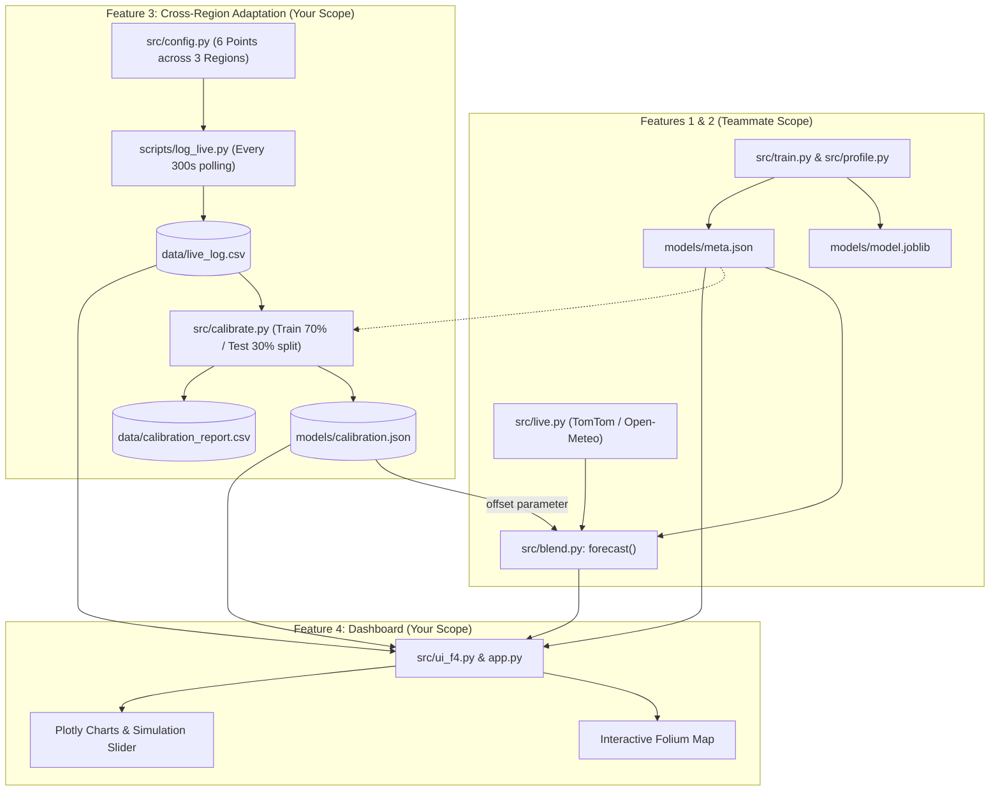

# IMPLEMENTATION & HANDOVER PLAN: Features 3 & 4
**Project:** Cross-Region Traffic Adaptation & Central Dashboard  
**Target Features:** Feature 3 (Cross-Region Calibration & Live Logger) & Feature 4 (Streamlit Central Dashboard)  
**Teammate Boundary:** Features 1 (Base Model & Profile) & Feature 2 (Live API Fetch & Blend Forecast)

---

## 1. Executive Summary & Architecture Alignment

This plan defines the engineering blueprint and clean contract boundary for building **Feature 3** and **Feature 4** in parallel with teammate-led **Features 1 and 2**.

To guarantee seamless integration and 100% transferability to your teammate without blocking or merge collisions:
1. **Strict Interface Contracts**: Every function signature, return structure, JSON schema, and CSV header shared across boundaries is explicitly defined.
2. **Self-Contained Mock & Decoupling Strategy**: Features 3 and 4 can be implemented, run, and verified locally **immediately**, even before Features 1 and 2 deliver final artifacts (`model.joblib`, `meta.json`, `blend.py`, `live.py`), by utilizing well-defined fallback fixtures.
3. **Zero Ambiguity File & Package Structure**: Direct file ownership and minimal-diff integration points are laid out with zero fluff.



---

## 2. Shared Interface Contracts (Handover Contract)

To eliminate runtime friction when merging branches or transferring code to your teammate, both sides must adhere to these exact contracts:

### Contract A: Point Configuration (`src/config.py`)
Both teams share this config file.
```python
REGIONS = {
    "mumbai": {
        "name": "Mumbai",
        "points": [
            {"point_id": "mum_we_highway", "name": "Western Express Highway (Bandra)", "lat": 19.0596, "lon": 72.8446},
            {"point_id": "mum_ee_highway", "name": "Eastern Express Highway (Chembur)", "lat": 19.0522, "lon": 72.8995}
        ]
    },
    "pune": {
        "name": "Pune",
        "points": [
            {"point_id": "pune_shivajinagar", "name": "Shivajinagar FC Road", "lat": 18.5314, "lon": 73.8446},
            {"point_id": "pune_hinjewadi", "name": "Hinjewadi Phase 1", "lat": 18.5913, "lon": 73.7389}
        ]
    },
    "konkan": {
        "name": "Konkan",
        "points": [
            {"point_id": "konkan_nh66_chiplun", "name": "NH66 Highway (Chiplun bypass)", "lat": 17.5323, "lon": 73.5178},
            {"point_id": "konkan_nh66_khed", "name": "NH66 Highway (Khed stretch)", "lat": 17.7214, "lon": 73.3934}
        ]
    }
}
```

### Contract B: Traffic Ratio to Level & Index Conversion (Agreed Rules)
Used uniformly across Features 2, 3, and 4:
- **Ratio Thresholds**:
  - `ratio > 0.8` $\rightarrow$ Level: `"Low"`, Midpoint index: `0.20`
  - `0.6 < ratio <= 0.8` $\rightarrow$ Level: `"Moderate"`, Midpoint index: `0.55`
  - `0.4 < ratio <= 0.6` $\rightarrow$ Level: `"High"`, Midpoint index: `0.80`
  - `ratio <= 0.4` $\rightarrow$ Level: `"Severe"`, Midpoint index: `0.95`
- **Level Color Codes**:
  - Low: `#28a745` (Green)
  - Moderate: `#ffc107` (Yellow)
  - High: `#fd7e14` (Orange)
  - Severe: `#dc3545` (Red)

### Contract C: Feature 1 Profile Evaluation (`src/profile.py` or fallback)
```python
def predict_profile(dt, weather=None) -> float:
    """
    Returns profile congestion index in [0, 1].
    - dt: datetime object
    - weather: dict or None (e.g. {'temp_c': 28.0, 'rain_mm': 0.0, 'clouds_pct': 20})
    Note: Holiday flag is always forced to 0 for regional evaluation.
    """
```

### Contract D: Feature 2 Forecast with Regional Calibration Offset (`src/blend.py`)
```python
def forecast(point_id: str, now_dt, offset: float = 0.0) -> dict:
    """
    Produces 7 horizons: [15, 30, 45, 60, 75, 90, 120] minutes.
    Returns:
    {
        "point_id": str,
        "current_ratio": float,
        "current_level": str,
        "current_index": float,
        "horizons": [
            {
                "minutes": int,
                "target_time": str (ISO or HH:MM),
                "live_weight": float,
                "history_weight": float,
                "predicted_index": float,   # clipped to [0, 1]
                "predicted_level": str
            },
            ...
        ]
    }
    """
```

### Contract E: Feature 3 Calibration Results (`models/calibration.json`)
```json
{
  "mumbai": {
    "offset": 0.082,
    "n_train": 70,
    "n_test": 30,
    "mae_before": 0.165,
    "mae_after": 0.091,
    "acc_before": 0.633,
    "acc_after": 0.800,
    "coverage": 0.98,
    "status": "calibrated"
  },
  "pune": {
    "offset": -0.041,
    "n_train": 70,
    "n_test": 30,
    "mae_before": 0.142,
    "mae_after": 0.085,
    "acc_before": 0.700,
    "acc_after": 0.867,
    "coverage": 0.95,
    "status": "calibrated"
  },
  "konkan": {
    "offset": 0.0,
    "n_train": 12,
    "n_test": 5,
    "mae_before": null,
    "mae_after": null,
    "acc_before": null,
    "acc_after": null,
    "coverage": 0.35,
    "status": "not enough data"
  }
}
```

---

## 3. Work Breakdown Structure (Phase-by-Phase)

### Phase 1: Environment Setup & Data Infrastructure (0:00 – 0:30)
*Target: Start logging live data immediately so maximum calibration rows accumulate.*
- **Step 1.1**: Verify dependencies in `requirements.txt`:
  - `pandas`, `numpy`, `scikit-learn`, `joblib`, `requests`, `streamlit`, `plotly`, `folium`, `streamlit-folium`, `python-dotenv`.
- **Step 1.2**: Create directory skeleton:
  - `src/`, `scripts/`, `data/raw/`, `data/processed/`, `models/`, `tests/`.
- **Step 1.3**: Implement `src/config.py` with the 6 verified coordinates and `data/sample_live.json` containing recorded fallback API responses for all 6 points.
- **Step 1.4**: Implement `scripts/log_live.py`:
  - Iterates through the 6 points every 300 seconds.
  - Queries TomTom Flow (or calls `src/live.py` / sample fallback if network drops).
  - Queries Open-Meteo weather API.
  - Appends directly to `data/live_log.csv` (unbuffered write with flush).
  - Run `scripts/log_live.py` in background immediately.

### Phase 2: Feature 3 – Cross-Region Adaptation Pipeline (0:30 – 1:30)
*Target: Automated time-based train/test splitting, bias offset calculation, and metric verification.*
- **Step 2.1**: Implement conversion utilities (`src/utils.py` or within `src/calibrate.py`):
  - `ratio_to_level(ratio: float) -> str`
  - `level_to_index(level: str) -> float`
  - `index_to_level(index: float) -> str`
- **Step 2.2**: Implement `src/calibrate.py`:
  - Load `data/live_log.csv`, filter for `api_ok == True`.
  - Check per-region usable row threshold: if $< 20$, write `status: "not enough data"`.
  - For each valid region:
    - Sort chronologically by `timestamp_ist`.
    - Split first 70% as **Train**, last 30% as **Test** (strict time hold-out, zero leakage).
    - For all rows, calculate `profile_index = predict_profile(dt, weather)`.
    - Compute `offset = mean(live_index - profile_index)` on **Train**.
    - Evaluate on **Test**:
      - `mae_before = mean(|profile_index - live_index|)`
      - `mae_after = mean(|clip(profile_index + offset, 0, 1) - live_index|)`
      - Level classification accuracy before vs after.
  - Save structured results to `models/calibration.json` and tabular summary to `data/calibration_report.csv`.
- **Step 2.3**: Unit Test `tests/test_calibrate.py`:
  - Test 1: Verify split is chronological and no future timestamps bleed into train set.
  - Test 2: Verify offset calculation math and bounds clipping (`0.0 <= index <= 1.0`).
  - Test 3: Verify regions with $< 20$ rows correctly return `status: "not enough data"`.

### Phase 3: Feature 4 – Interactive Streamlit Dashboard (1:30 – 2:40)
*Target: Single-page executive dashboard with Map, Forecast, Simulation Slider, and Regional Comparison.*
- **Step 3.1**: Implement `src/ui_f4.py`:
  - **Sidebar Controls**:
    - Region selection (`Mumbai`, `Pune`, `Konkan`).
    - Point selection (filtered by chosen region).
    - Forecast horizon selector (15, 30, 45, 60, 75, 90, 120 mins).
    - "Refresh Live Data" button (`st.cache_data(ttl=120)`).
    - "Simulate live speed ratio" slider (0.1 to 1.0, step 0.05) with enable checkbox.
  - **Section 1: Live Status & Interactive Map**:
    - Embedded `folium.Map` using `streamlit_folium.st_folium`.
    - 6 `CircleMarker` nodes colored by condition (Green, Yellow, Orange, Red).
    - Radio toggle: "View Current Condition" vs "View +Horizon Prediction".
    - Metric cards: Current Level vs Forecasted Level, with a clear badge indicating `[Calibrated (Offset: +X.XX)]` or `[Uncalibrated]`.
  - **Section 2: Forecast & Weighting Charts**:
    - 7-horizon forecast curve (Plotly).
    - Weight distribution breakdown (Live Weight vs Historical Profile Weight).
  - **Section 3: Regional Adaptation Comparison (The Teammate & Judge Highlight)**:
    - Bar chart comparing Mumbai, Pune, and Konkan current vs +60 min predicted index.
    - Side-by-side metric table showing: Region, Status, Offset, Train/Test rows, MAE Before vs MAE After, Accuracy Improvement.
    - Fallback banner if live API is unreachable, confirming sample data is displayed safely.
- **Step 3.2**: Implement `app.py`:
  - Main Streamlit entrypoint configuring wide layout, page title, and delegating to `ui_f4.render()`.

### Phase 4: Integration, Validation & Handover Package (2:40 – 3:30)
- **Step 4.1**: Integration Check with Features 1 & 2:
  - Plug teammate's real `models/meta.json` and `src/blend.py` into `src/calibrate.py` and `src/ui_f4.py`.
  - Verify that passing `offset` into `forecast(location, now, offset=offset)` adjusts the blend predictions smoothly.
- **Step 4.2**: Execute End-to-End Run:
  - Run `python scripts/log_live.py --once`
  - Run `python src/calibrate.py`
  - Run `streamlit run app.py`
- **Step 4.3**: Provide clear handover checklist and documentation for your teammate.

---

## 4. File-by-File Ownership & Handover Matrix

| File Path | Responsible Owner | Purpose | Teammate Touchpoint |
|---|---|---|---|
| `src/config.py` | Shared (You init) | Stores regions, coordinates, API endpoints | Teammate uses it for Feature 2 point lookups |
| `scripts/log_live.py` | **You (F3)** | Background 5-min poller writing to `data/live_log.csv` | Independent daemon; teammate just reads CSV |
| `src/calibrate.py` | **You (F3)** | Computes regional offset, MAE before/after | Exports `models/calibration.json` consumed by F2/F4 |
| `src/ui_f4.py` | **You (F4)** | Complete Streamlit dashboard UI components | Imports F1/F2 chart helpers or uses internal fallbacks |
| `app.py` | **You (F4)** | Main Streamlit runner | Single launch command: `streamlit run app.py` |
| `data/sample_live.json` | **You (F3/F4)** | Fallback fixtures for offline demo safety | Teammate can run UI without live internet |
| `tests/test_calibrate.py`| **You (F3)** | Automated tests for calibration math & splitting | Automated CI / test verification |

---

## 5. Teammate Transfer & Handover Package Instructions

To ensure your teammate can take over or integrate Features 3 & 4 with zero friction:

1. **How to Run Feature 3 (Calibration)**:
   ```bash
   python src/calibrate.py
   # Generates: models/calibration.json & data/calibration_report.csv
   ```
2. **How to Run Feature 4 (Dashboard)**:
   ```bash
   python -m streamlit run app.py
   ```
3. **If Teammate's F1/F2 Code Is Not Ready Yet**:
   - `src/calibrate.py` and `src/ui_f4.py` will include clean standalone mock fallbacks for `predict_profile()` and `forecast()` so the dashboard runs out-of-the-box.
   - Once your teammate finishes `src/blend.py`, simply swap the mock import with `from src.blend import forecast`.
